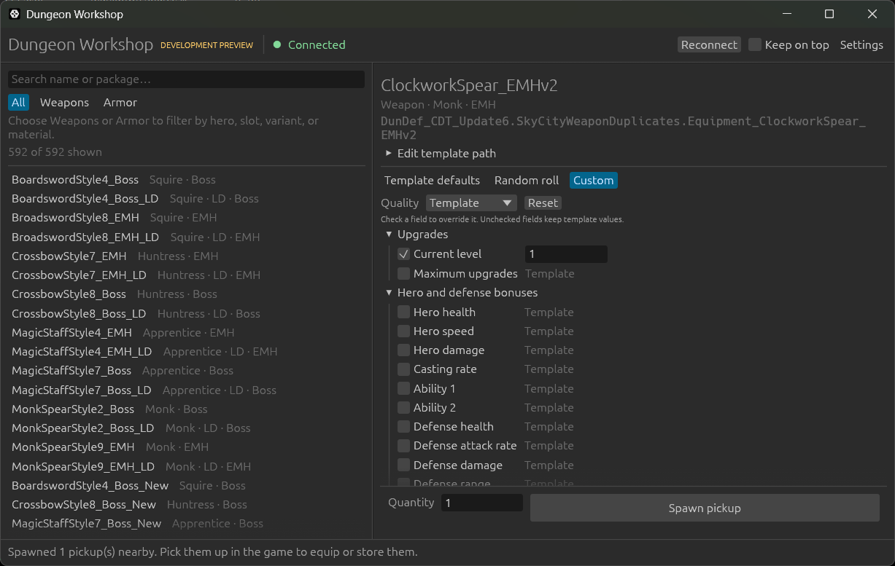

# Dungeon Workshop

A small Rust overlay and native adapter for experimenting with equipment in
Dungeon Defenders single-player.

**Status: v0.2 single-player preview for Steam build 25809881.** Choose
equipment and spawn it beside your hero, then pick it up normally. The weapon
and armor spawn path was verified in a regular tavern, including user-confirmed
pickup. The catalog contains 592 weapon/armor references; not every entry has
been individually tested. Choose template defaults, a game-generated random roll,
or custom quality and stat overrides. Custom weapon and armor values have been
read back after normal pickup into the item box.



## Run the preview

1. Extract the complete portable ZIP into any writable folder.
2. Start Dungeon Defenders and enter a regular **local single-player** map/tavern.
3. Run `dd-overlay.exe` and click **Connect to game** in the top bar. The first
   connection briefly pauses gameplay while inspecting reflection metadata.
4. Search or filter the equipment list on the left, select an item, and choose
   **Template defaults**, **Random roll**, or **Custom**. Choose quantity and click
   **Spawn pickup**.
5. Pick it up in-game to equip or store it. Collected items appear in your item
   box. Normal game saves can retain picked-up items.

Install path, disconnect and the isolated adapter test are under **Settings**.
Status and search progress appear in the bar at the bottom of the window.

In **Random roll**, choose **Any** quality for an ordinary roll, or select a tier
to search naturally generated rolls for an exact match. The strength slider
(0.01–2.0), template settings and selected **Loot conditions** determine the rolls.
The tool never relabels an unsuccessful roll or changes its stats to force a match.
Some templates cannot produce every tier or disable randomization entirely.

**Current mission** preserves the game's current map/difficulty modifiers.
**Tavern testing** uses a fixed high-level testing profile anywhere: a 33.0 mission
multiplier override, each template's last configured difficulty-specific upgrade
range, and its normal (non-Ruthless) Ultimate promotion probabilities. The game
still rolls stats, negative bonuses, upgrade counts and quality itself. This is a
testing profile, not a reproduction of one particular map's loot distribution.
It changes only newly created temporary equipment, never live game difficulty or
shared templates. **Any** quality also works with Tavern testing; multiple items
are paced one at a time. Unreachable tiers can still exhaust the search limit.

Searches stop after 200 candidates or 15 seconds across the requested quantity.
The app waits at least 50 ms between single-candidate game-thread requests;
rejected candidates never become floor pickups. **Cancel search** stops further
attempts after the current request finishes. Progress and the final message report
how many pickups were actually spawned, including partial results. Communication
errors stop the search without retrying an uncertain spawn. A candidate taking
over 8 ms stops the search; an individual game script call cannot be interrupted.

In **Custom**, select a quality or keep **Template**, then check only the fields
you want to override. Unchecked values remain inherited. Hero/defense bonuses,
armor resistances, weapon bonuses and upgrade counts are supported. Weapon
controls are **bonuses**, not final displayed totals; a weapon may not use every
bonus. Elemental damage keeps the template's element. Special items can retain
their fixed name and beam color even with a different quality tier.

Type quantities and custom values directly into their text boxes. Adjust roll
strength with the slider.
Dragging selects text without changing the number. Empty, incomplete and
out-of-range entries disable spawning until corrected.

The editor bounds hero bonuses to ±9999, damage/ammo to 0–1000000, projectile
speed bonus to ±1000000, resistances to 0–100, and upgrades to 1–9999. These are
tool limits, not normal loot caps. Small weapon bonuses are limited to −127–128
because larger values wrap in the game's serialization. The adapter also checks
template minimum damage/upgrades and rejects a current level above the maximum.
Leave both upgrade fields unchecked to preserve template defaults.

Keep the three matching binaries together;
restart the game before replacing an older attached adapter.

**Run isolated adapter test** is a separate diagnostic; it never connects to the
game or creates equipment. **Check** only inspects the installation.

Keep these three files together:

```text
dd-overlay.exe          # 64-bit desktop UI
dd_adapter.dll          # 32-bit native Rust adapter
dd-adapter-host.exe     # 32-bit attachment helper and isolated test host
```

No installer, Rust runtime, administrator rights, or changes to the game's folder
are required to run this preview. Use windowed or borderless gameplay for the
external always-on-top panel. Exclusive fullscreen rendering and a global toggle
hotkey are not implemented.

The game path is detected from common Steam libraries; it can also be entered
manually. Detection checks PE architecture and the executable's SHA-256. A
recognized executable is required for attachment. The adapter also checks live
reflection layouts, game thread, standalone mode and local hero ownership before
spawning. Other builds and ranked/online sessions are unsupported. Templates
must already be loaded; reconnect after changing maps if a reference is missing.

Closing the overlay disconnects its helper without closing the game. The adapter
DLL stays loaded and idle until game exit, so restart the game before updating
or deleting an attached release. Uninstall by closing both apps and deleting
the extracted folder. Nothing is installed into the game's directory.

## Build

Windows 10/11 x64 is required. Install these development tools once:

1. Install [Rust using rustup](https://rust-lang.org/tools/install/) with the MSVC
   toolchain. Rust lives in `%USERPROFILE%\.cargo` and `%USERPROFILE%\.rustup`.
2. In Visual Studio Installer, install or modify **Build Tools 2022**, selecting
   **MSVC v143 C++ x64/x86 build tools** and **Windows 11 SDK (10.0.22621.0)**.
   These are installed in the standard Program Files locations.

The repository's `rust-toolchain.toml` selects Rust 1.99.0, rustfmt, Clippy, and
both Windows MSVC targets. Rustup downloads missing components on first use.
End users of the portable ZIP do not need development tools.

Double-click **build.cmd**, or run this command from the repository:

```powershell
powershell -NoProfile -ExecutionPolicy Bypass -File .\build.ps1
```

The script checks formatting, runs Clippy for the overlay and 32-bit adapter,
runs workspace tests, and builds and tests the release package. Each build goes
into a new timestamped folder under `dist/`, containing the portable ZIP and its
SHA-256 checksum. Compilation is cached in `target/`. No Codex folder or tools
are required. The first build needs internet access to download Rust components
and Cargo dependencies.

Optionally pass `-OutputDirectory <fresh-folder>` to choose an output location.
For packaging without the initial formatting, Clippy, and unit-test checks, use
`scripts/package.ps1 -OutputDirectory <fresh-folder>`; this still runs the adapter
smoke and transport tests. The CRT is linked statically. Packaging uses an
explicit file list and never includes game binaries or assets.

To test an extracted release without opening a window:

```powershell
.\dd-overlay.exe --self-test
.\dd-overlay.exe --check-game '<game-installation-folder>'
```

The test loads the real DLL, verifies the server process and architecture, checks
invalid input and version rejection, confirms the isolated host cannot spawn, then
requests shutdown and checks that the host exits successfully.
Packaging additionally exercises fragmented messages, oversized frames and
stalled clients against the real DLL using `scripts/transport-test.ps1`.

## Design

- `crates/overlay`: egui/eframe window, equipment search, game identification and
  helper lifecycle. Connections and requests run outside the UI thread.
- `crates/protocol`: concrete versioned messages and Windows named-pipe transport.
  Requests contain semantic item paths, quantities and typed item options, never
  game pointers.
- `crates/adapter`: build validation, a thread-specific Windows message hook,
  reflected engine bindings, local-session guards and confirmed pickup creation.

The x86 helper loads the adapter using a thread-specific `WH_GETMESSAGE` hook in
the verified game's window thread. Native analysis and runtime reads established
that it matches the engine's game thread. Requests travel from the pipe worker
through a bounded queue to that callback. Expired queued requests cannot execute
later, and an ambiguous running operation is never retried automatically. There
is one attachment per game process. The DLL is pinned to make disconnect safe.

The pipe rejects remote clients, verifies the server PID on connection, limits
frames to 16 KiB, and applies a two-second I/O deadline. One connection carries
one request and response. The protocol is deliberately small; it has no arbitrary
command execution or memory-write operation.

## Current limits

- Supports one local player on the verified Windows x86 game build.
- Creates floor pickups with defaults, random rolls, or explicit custom overrides.
- Custom mode starts from template defaults; it does not reroll before applying overrides.
- No direct inventory insertion, package loading, pets or accessories.
- Save/reload persistence and every catalog variant have not been tested.
- After an uncertain response, inspect nearby pickups before trying again.

See [runtime verification](docs/runtime-verification.md) for the checked bindings,
live results and limits, and [the original investigation](docs/integration.md)
for the item-box route. No custom map or Total Conversion is required.

This repository contains original tool code and equipment object-path references;
it does not redistribute Dungeon Defenders assets, scripts or decompiled code.
